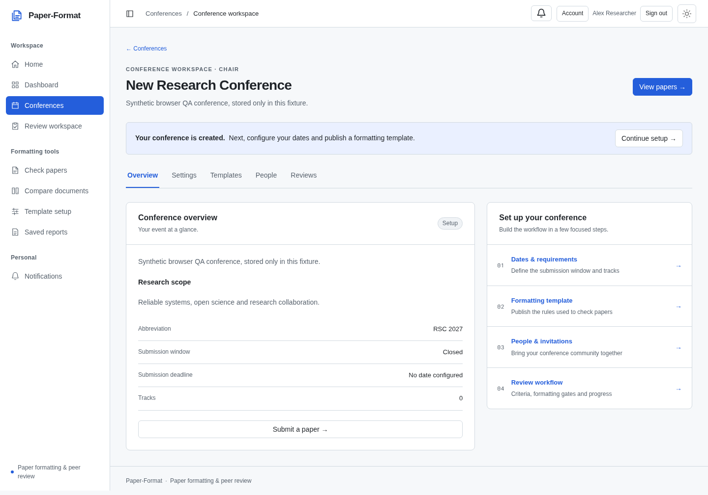
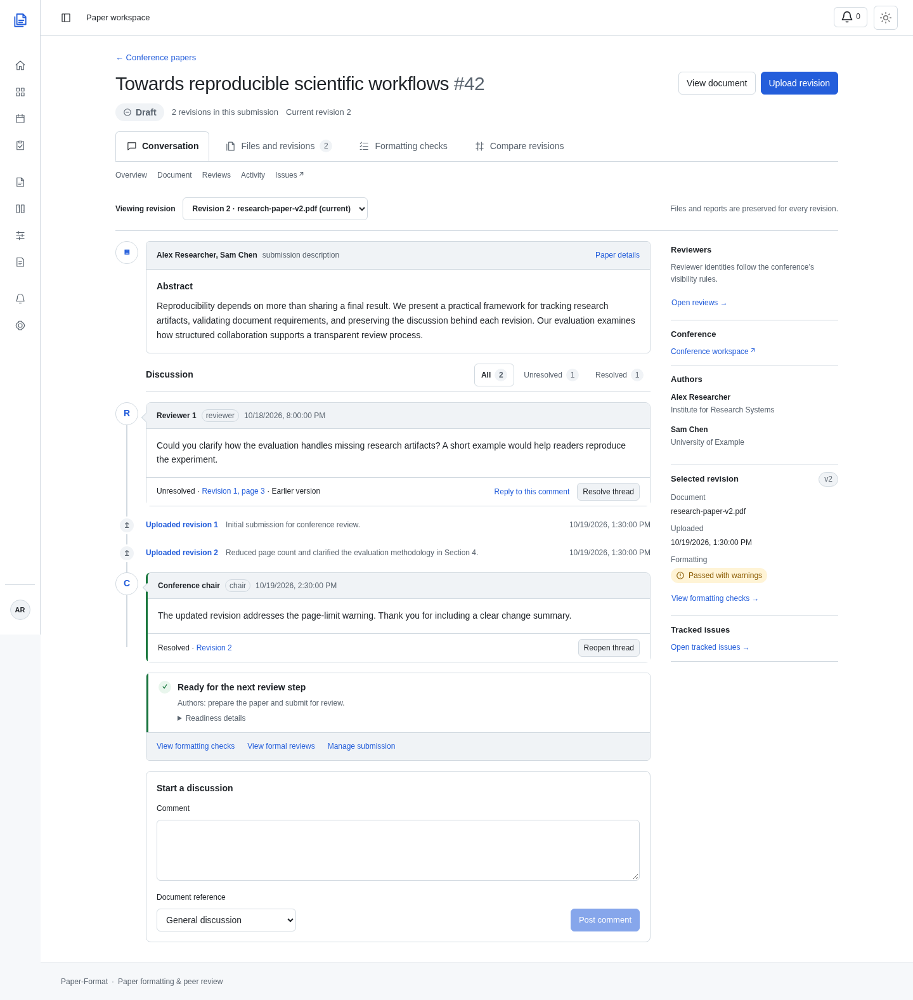
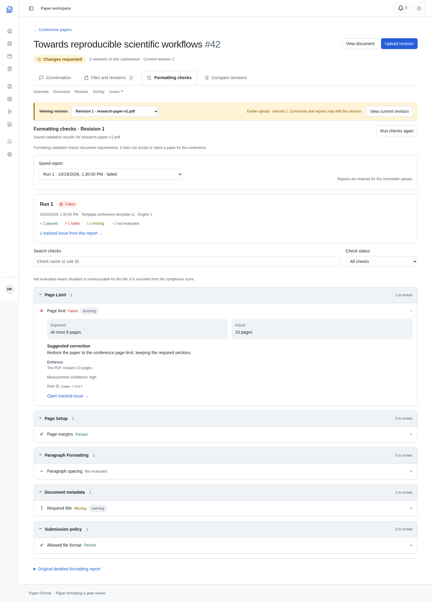
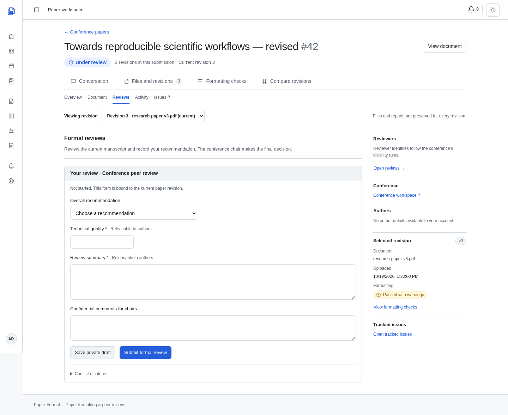
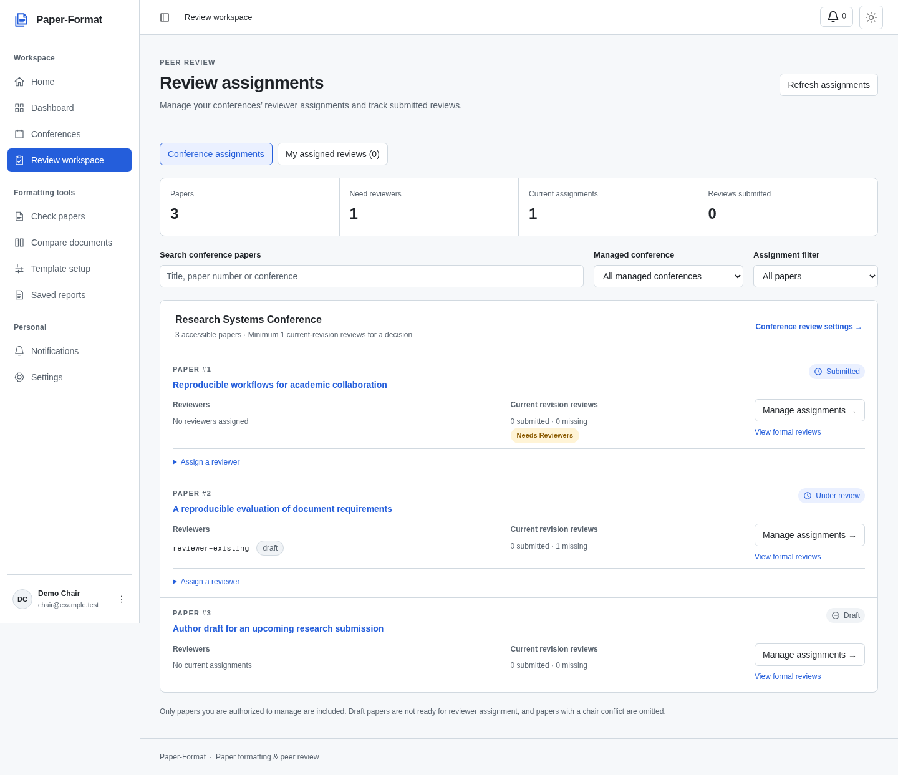

# Paper-Format

## Conference Paper Submission, Formatting Validation and Peer Review Platform

**Detailed implementation and progress report**  
**Prepared for:** Faculty / project mentor review  
**Report date:** 19 October 2026  
**Current stage:** Integrated local prototype with implemented submission and review workflows; interface refinement and production preparation continue.

## Executive summary

Paper-Format has been extended from an existing research-paper formatting checker into a conference submission and review platform. The original document parsers, configurable formatting rules and standalone checking workflow have been preserved. Conference management, accounts, paper submissions, immutable revisions, discussions, reviewer assignments, formal reviews, decisions, invitations and in-app notifications have been added around that foundation.

The central idea is to treat a paper submission as an ongoing collaboration workspace, similar to a GitHub Pull Request. Authors can submit a paper, inspect formatting findings, discuss feedback and upload revisions without losing previous files. Reviewers can inspect the document, discuss particular revisions and submit structured recommendations. Conference chairs configure requirements, manage participants and reviewers, and record editorial decisions.

The application is implemented as a React frontend communicating with a FastAPI backend, using SQLite persistence and protected document storage. The interface uses PaperFox-inspired conference management patterns and GitHub-inspired paper workspaces. The system is demonstrable locally; this report does not claim a completed production deployment, perfect formatting detection or a complete reproduction of either reference product.

## 1. Problem statement and project objectives

Conference paper handling involves several related tasks: checking submission requirements, managing deadlines, distributing papers to reviewers, collecting feedback and preserving revision history. A formatting checker addresses only part of this process. When these tasks are split across email, shared folders and separate forms, participants can lose track of the current file, the feedback it addresses and the reason for a decision.

The project therefore extends the existing checker into one connected workflow. Its objectives are to:

- Preserve standalone paper and template comparison rather than replace the existing application.
- Let organizers configure conferences, tracks, submission requirements and versioned templates.
- Give each paper a stable submission identity and conference paper number.
- Retain original files, revisions, saved formatting runs and the feedback attached to them.
- Separate ordinary discussion, automated formatting findings, formal recommendations and final decisions.
- Enforce access through the backend, including conference roles, paper collaboration permissions and reviewer assignments.
- Provide a usable interface for authors, reviewers and chairs, including small screens and light/dark themes.

## 2. System architecture and technology

### 2.1 Main components

| Layer | Technology / implementation | Responsibility |
|---|---|---|
| Frontend | React 19, React Router 7, Vite 7 | Pages, navigation, forms, document workspace and user interactions. |
| Styling | Tailwind CSS 4 and shared application CSS tokens | Consistent colors, typography, controls, states and responsive layouts. |
| API communication | Axios | Authenticated requests, uploads, error handling and responses. |
| Backend | Python, FastAPI, Pydantic | API routes, validation, workflow rules, authorization and orchestration. |
| Document processing | PyMuPDF and project-specific PDF, DOCX and LaTeX parsers | Extract document structure and supported formatting properties. |
| Persistence | SQLite stores, explicit transactions and versioned migrations | Accounts, conferences, submissions, reports, collaboration and review records. |
| File handling | Private storage keys, authorized file endpoints and SHA-256 integrity checks | Preserve and protect manuscript files. |
| Testing | pytest, isolated React/JSDOM harnesses and Chromium browser checks | Backend behavior, frontend/API wiring and visual/interactivity checks. |

### 2.2 How the layers connect

```text
Author / Reviewer / Conference Chair
                  |
           React web application
                  |
          FastAPI application APIs
                  |
       Authentication and paper access
                  |
    Conference / Submission / Review services
             /                 \
     Formatting pipeline     Collaboration workflow
             \                 /
      SQLite records + protected document files
```

The backend entry point is `backend/app/main.py`; the frontend entry point is `frontend/src/main.jsx`, with routes in `frontend/src/App.jsx`. The formatting pipeline is a reusable service, so the standalone checker and conference revisions use the same document-evaluation logic.

## 3. Accounts, roles and access control

Email/password registration and sign-in, cookie sessions, sign-out and an account/settings page are implemented. Google sign-in and account linking have also been implemented, but availability depends on valid provider configuration and the running deployment.

Roles belong to conference memberships. A single account can therefore be an author in one conference and a reviewer or chair in another. The current conference role values are owner, author and reviewer; the owner acts as conference chair/organizer. Paper co-authorship and editing access are handled separately from a name appearing in the manuscript's bibliographic author list.

| Participant | Implemented responsibilities and limits |
|---|---|
| Conference chair / owner | Configure the conference and review policy, manage participants and templates, assign reviewers, inspect permitted review progress, release reviews and make decisions. |
| Submitting author | Create an eligible submission, manage its declared metadata, upload permitted revisions, discuss feedback and manage allowed collaborators. |
| Editing co-author | Read and discuss an authorized paper; upload/edit when granted paper editing access. |
| Read-only collaborator | Read and discuss the authorized paper without receiving upload/edit rights. |
| Assigned reviewer | Read assigned papers, access permitted files, discuss feedback and use the configured formal-review workflow. |
| Unauthenticated visitor | Access public entry pages and available standalone tools; private conference papers and reviews require authorization. |

Conference membership alone does not make every paper visible. File downloads, previews, comments, issues and review operations are checked against the relevant paper and user. Reviewer identities and confidential content follow backend visibility rules. A dedicated track-chair role and a complete global administration product are not claimed as implemented.

## 4. Conference management and submission intake

Organizers can create conferences and manage their settings, participant memberships and paper tracks. Conference configuration includes descriptive information, research scope, website, lifecycle phase, submission/revision windows and required paper metadata. The UI provides a conference directory, a creation form, a conference workspace and separate areas for papers, people, templates, settings and review management.

Submission requirements are connected to conference-specific template versions and workflow policies. The system can require a title, abstract, bibliographic authors and an active track before a paper proceeds. Allowed document formats and page limits are expressed through the existing rules and configuration rather than a second formatting engine.

The submission form is separate from the paper listing. An author chooses the conference, supplies required metadata and uploads a manuscript through its submission route. Each conference paper receives a human-readable paper number in addition to its stable internal identifier. Metadata updates are versioned and distinguish declared submission information from information extracted from a particular file.

Participant invitations use private invitation links. Recipients inspect and explicitly accept the invitation after signing in with the intended account. Expiry and revocation are supported. Creating a link is implemented; automatic production email delivery is not represented as a completed feature.

## 5. Document processing and formatting validation

### 5.1 Existing functionality retained

The application still supports standalone paper checking, multiple-paper uploads, template-versus-paper comparison, template importing/editing, saved reports and the existing Google Drive import path. PDF, DOCX and LaTeX source files are supported. A conference submission is an additional entry into the same processing foundation.

### 5.2 Actual processing sequence

1. **Receive and validate the upload.** Check supported formats, configured byte limits and document/container safety before processing.
2. **Parse the document.** The format-specific parser produces the shared normalized representation through `normalize_document()`.
3. **Extract facts.** `build_facts()` collects available file, layout, typography, structural, identity and format-specific information.
4. **Load the applicable rules.** Standalone checks use the selected template; conference revisions use their pinned conference template version.
5. **Evaluate requirements.** The rule engine compares the extracted facts with configured requirements and creates structured check results.
6. **Build the assessment.** The output contains a compliance score, results, severity, evidence, available correction advice and extraction confidence.
7. **Persist and display.** Conference runs are saved against their immutable revision and displayed through Formatting Checks; standalone reports remain available through the existing results/report workflow.

The shared `evaluate_document()` service is in `backend/app/services/formatting.py`. It invokes document validation, normalization, fact extraction and assessment. The implemented checker is based on parsing and configurable rules; a formatting result is not a semantic judgment of research quality.

### 5.3 Supported facts and measurement limits

| Information | Current support and qualification |
|---|---|
| File identity | Filename, document format, size and content hash. |
| Title and author information | Available declared/extracted title and author blocks, with format-dependent extraction. |
| Page layout | PDF page count, page size, margins, orientation and column information where measurable. Source-only documents do not guarantee a final rendered page count. |
| Typography and paragraphs | Available font/size, alignment, spacing and indentation information. Reliability varies by format and document structure. |
| Sections | Abstract, keywords, headings, required sections and available reference information. |
| LaTeX details | Document class, options, selected packages/macros, geometry settings and unresolved includes where detected. |
| Identity leakage | Supported signals such as author blocks, email addresses, affiliations, acknowledgements, funding or document metadata. These checks do not guarantee anonymity. |
| Tables, figures and related assets | Available counts and evidence with confidence information; heuristic counts are not treated as exact knowledge. |

Individual results distinguish passed, failed, missing and not applicable. Not applicable can mean a rule is disabled or the property cannot be measured reliably. It is excluded from the score denominator. Confidence and evidence help users decide when manual inspection is necessary.

At run level, the platform distinguishes passed, passed with warnings, failed and unable to validate. The UI shows processing while a request is active. A formatting pass does not mean the paper has been accepted by the conference.

## 6. Paper submission lifecycle

Submission status is separate from formatting status and review recommendation. The implemented state machine uses the following principal paths:

```text
Draft -> Submitted -> Under review -> Accepted / Rejected
                            |
                     Changes requested
                            |
                  New revision -> Submitted

Withdrawal is available from permitted non-final states.
```

The backend defines explicit transitions rather than accepting arbitrary status changes. Drafts can be submitted or withdrawn. Submitted papers can enter review, be rejected or be withdrawn. Papers under review can receive a change request or a final decision. Changes-requested papers can be resubmitted after correction or withdrawn. Accepted, rejected and withdrawn states are terminal in the current model.

Formatting eligibility, required metadata, submission windows, the review phase, reviewer conflicts and review/decision policies affect which actions are allowed. Conferences can use blocking formatting requirements or permit findings to proceed under the configured policy. Expected-status and expected-revision guards prevent a stale browser view from applying an action to a newer state accidentally.

## 7. Revisions, comparison and document-linked feedback

### 7.1 Immutable manuscript history

Each upload creates a new paper revision. Earlier files are retained rather than overwritten. Revision records include their number, parent relationship, uploader/time, file size, content hash, extracted information and associated formatting runs. Rechecking retains earlier saved runs as well.

This makes it possible to answer which file was reviewed, which template applied, which findings existed at that time and what changed after feedback. Upload retries use the existing idempotency mechanism, helping prevent accidental duplicate revisions. Integrity verification checks stored bytes before protected processing and access paths.

### 7.2 Implemented comparisons

- **Text comparison:** compares extracted text and reports additions/removals. It does not prove semantic equivalence or a visual layout change.
- **Property comparison:** compares supported document facts and retains measurement/confidence limitations.
- **Formatting comparison:** compares saved findings, identifying resolved, new and remaining findings and relevant status changes. Exact run selections remain distinguishable from a latest-run choice.
- **File identity:** hashes identify identical file bytes; identical bytes do not imply that different template versions would produce identical assessments.

Visual PDF overlay/pixel comparison has not been implemented as a production feature. It remains optional future work.

### 7.3 Discussion and annotation behavior

General conversations support threaded replies, permitted editing/deletion, resolution/reopening and participant/chair-only visibility. Comments can reference a revision and, where supplied, a page. Protected PDF preview supports page-centered review. DOCX/LaTeX remain downloadable rather than being presented as already converted PDFs.

An earlier comment remains attached to its original revision. It is not silently moved to a new upload. The current implementation provides page/revision references; reliable selected-text tracking, bounding-box annotations and automatic cross-version re-anchoring are not claimed.

Tracked issues refer to existing formatting findings. They have status, severity, permitted assignment, expected/actual information, evidence, correction guidance and their own discussion. Original revision/run links preserve the source of a finding. Resolving an issue does not rewrite the original saved formatting result.

## 8. Formal peer reviews and conference decisions

Conference review configuration defines recommendations and review criteria, including text answers and bounded scores. This allows events to ask for their own technical quality, presentation, relevance or other criteria rather than requiring one fixed form for every conference.

Reviewers can save a private draft and submit a formal review under the configured rules. The workflow records the assignment, reviewed revision, form version and review version. Confidential comments for chairs are separate from feedback that may be released to authors. Selecting an earlier manuscript revision disables editing that must target the current revision.

Chairs can assign/revoke reviewers, inspect permitted review progress, manage conflict declarations, release submitted reviews under policy and record decisions. A reviewer can declare a conflict and recuse through the existing workflow. Decision guards consider the relevant revision, review policy and required review count. Reviewer recommendation, formatting compliance and final editorial decision are distinct concepts throughout the platform.

The shared review-assignment workspace is role aware. A chair sees accessible papers across the conferences they manage, existing reviewer assignments, submitted/missing review counts and papers needing reviewers. Search and conference/assignment filters help organize this work. A chair can assign an available conference reviewer through the existing API, with server-side conflict, eligibility and formatting checks. A separate personal view retains papers assigned to the signed-in account. This fixes the earlier situation in which a chair with no personal review assignments saw an empty reviewer list despite managing conference submissions.

The implementation filters reviewer identities and unreleased/private review information according to its access policies. Formatting anonymisation checks and reviewer-identity filtering should not be described as a guarantee of a fully anonymous or universally double-blind conference process.

## 9. Frontend design and recent refinements

### 9.1 Conference and personal workspace

PaperFox was studied as a reference for conference dashboards, paper lists, forms, participant management, settings and personal navigation. Paper-Format uses original components with shared semantic colors, typography, borders and controls. The bottom-left account menu links to settings, invitations, schedule and documentation. The application includes a notification center, profile/settings, reviewer workspace and schedule/deadline views.

### 9.2 GitHub-inspired paper workspace

GitHub individual public PR pages and Primer documentation were inspected before the paper workspace refinement. The paper page now opens on Conversation and has four principal tabs: Conversation, Files and revisions, Formatting checks and Compare revisions. Overview, Document, Reviews, Activity and Issues remain secondary tools. Existing deep links and revision/report selections are preserved.

The workspace contains a title/paper-number header, actual submission status, revision selector, paper-description card, chronological upload/discussion timeline and a permission-filtered sidebar. Formal reviews use the same paper frame. Current workflow readiness remains separate from the selected historical upload.

Recent refinement addressed oversized and crowded sections: a narrower reading column, fewer repeated sidebar values, one discussion/filter row, compact comment actions, expandable workflow details, a smaller comment composer and grouped review-score fields. Body text remains readable, mobile controls retain their touch targets, and long content wraps within the page. Light/dark themes and loading, empty and recoverable error states are supported.

No GitHub/PaperFox source code, logos or proprietary assets were copied into the application. Screenshots used for the implementation review are reference evidence or synthetic local test views.

## 10. Persistence, security and processing reliability

### 10.1 Data organization

| Data group | Examples of actual persisted records |
|---|---|
| Identity and membership | Users, authentication sessions, Google identities, conferences and conference members. |
| Conference configuration | Settings, tracks, versioned templates, review forms/policies and invitation records. |
| Submission history | Submissions, security/collaborator access, metadata versions, paper revisions and revision checks. |
| Collaboration | Paper threads/comments, tracked issues, issue comments and issue-to-finding relationships. |
| Reviews and accountability | Reviewer assignments, formal review versions/releases, conflicts, paper decisions, paper events and security events. |
| Updates and standalone results | Notifications and saved formatting reports. |

SQLite transactions coordinate related writes. The repository contains explicit, versioned migrations and compatibility checks. Existing data is not treated as disposable; older installation upgrades require the documented activation process rather than an implicit destructive reset.

### 10.2 Implemented safeguards

- Password hashing and authenticated browser sessions; session cookies are protected from direct JavaScript access.
- CSRF token checks, origin validation, configured cross-origin access and login/request throttling.
- Backend authorization for paper reads, revision files, previews, discussions, issue mutations and review actions.
- Safe display names and private storage keys rather than trusting uploaded filenames as filesystem paths.
- Configured upload/body limits, supported-format validation and relevant document/container checks.
- SHA-256 integrity checks, immutable revision records and controlled report access.
- Private/no-store API responses, security-related response headers and audit/activity records.

These are implemented protections, not a claim of a completed penetration test, legal/compliance certification or a full retention/deletion administration system.

### 10.3 Processing model

Parsing, checks and comparisons are currently request-driven. Expensive operations use the existing thread-pool integration where implemented, and the frontend shows busy/error states. The application does not currently provide a durable job queue with persisted queued/running states, automatic restart recovery or scheduled retry workers. Those additions should follow measured workload and reliability requirements.

## 11. Integrations, testing and evidence

### 11.1 External services

Google sign-in/account linking and Google Drive import are implemented integration paths. Both require valid credentials, provider permissions and deployment configuration. They must be verified in the target environment. The report does not claim that an arbitrary local environment is already configured or that live Google access was retested during the UI refinement.

Invitations use private acceptance links; in-app notifications provide unread counts/history and read controls. Periodic refresh is used for supported updates. Production email delivery and WebSocket-based real-time collaboration are not represented as completed features.

### 11.2 Verification records

| Evidence | Recorded result / scope |
|---|---|
| Latest paper-workspace suite | 20 isolated scenarios passed, including roles, revisions, deep links, comments, workflow guards and private review-draft payloads. |
| Latest document-review suite | 11 isolated scenarios passed, including protected preview lifecycle, page anchors and shared comment actions. |
| Management and chair-assignment suite | 28 isolated scenarios passed, including role separation, conference progress, assignment confirmation, denied requests, filtering and retry. |
| D3 Checks/Issues suite | 15 isolated scenarios passed during the D3 implementation: saved results, filters, issue origins, comments, denied writes and retries. |
| Browser QA | Synthetic API journeys at 1440, 1024, 768, 390 and 320 px, including light/dark views and relevant interactions. |
| Frontend production build | Passed. The existing JavaScript chunk-size advisory remains; bundle/performance optimization is still useful. |
| Earlier backend baseline | PHASE10.md records 393 passed and 8 optional-fixture skips. This is historical evidence, not a newly rerun backend result for the UI-only refinement. |
| Repository checks | The recent UI work passed whitespace/diff checks and did not change backend files or install component libraries. |

Test totals from different implementation stages should not be added together as if they were one current full-system run. The latest isolated UI tests use synthetic responses and do not mutate the user's database. Earlier phase notes and the demo walkthrough record additional backend and local-demo verification, while a fresh comprehensive deployment acceptance run remains separate work.

Docker/Compose and GitHub Actions CI configuration are present in the repository. Their presence is deployment support, not evidence that a production host is currently running successfully.

## 12. Suggested demonstration for the teacher

1. Start the existing backend and frontend, then open the application in the browser.
2. Sign in as the demo chair and open the separate demo conference. Show settings, tracks, participants and the pinned template/review policy.
3. Switch to the author account and open a paper. Explain the paper number, current revision, lifecycle status and conversation timeline.
4. Open Formatting Checks. Expand a supported finding and explain expected/actual values, severity, evidence and not-evaluated results.
5. Follow a tracked issue to its original revision/run. Add a discussion comment or demonstrate a permitted issue update.
6. Show the protected PDF preview and a page-linked discussion. Select an earlier revision to demonstrate that the anchor stays on the original file.
7. Open Files and revisions and Compare revisions. Explain the difference between text, property and finding comparison.
8. Sign in as the reviewer. Open the assigned paper, fill its configured review form and save a private draft. Explain confidential chair comments and historical-revision editing restrictions.
9. Return as chair to inspect review progress and demonstrate a policy-permitted release, change request or decision using a suitable demo paper.
10. Show the activity/notification views, then briefly demonstrate the retained standalone checker.

The demo includes a separate conference, chair/author/reviewer accounts and papers initially covering draft, submitted, under-review, changes-requested and accepted states. Demonstration actions modify that demo, so the current statuses may differ from their initial values. Credentials are intentionally excluded from this shareable report; use the local demo instructions in `docs/DEMO_WALKTHROUGH.md`.

### Local startup with existing dependencies

From the repository root, in one terminal:

```bash
PYTHONPATH=backend .venv/bin/python -m uvicorn app.main:app --reload --host 127.0.0.1 --port 8000
```

In a second terminal:

```bash
cd frontend
npm run dev
```

The usual frontend URL is `http://localhost:5173`; backend API documentation is at `http://localhost:8000/docs`. The configured database, environment variables and local dependencies must already be available. These commands do not create users, install packages or run migrations.

## 13. Remaining work and learning outcomes

The core local submission-to-review workflow is implemented. Remaining priorities are continued refinement of files/comparison/review-history screens, broader user acceptance testing, production configuration and operational validation. This includes HTTPS/cookie/origin configuration, provider setup, backups, retention/deletion policy, email delivery if required, accessibility review and performance testing.

Optional future features include visual PDF comparison, reliable selected-text/bounding-box annotations, richer notification delivery and durable background processing. They should be distinguished from the existing text/property/finding comparisons, page comments and request-driven processing.

The work demonstrates full-stack integration, configurable document validation, state-machine design, access control, immutable data history, revision-aware collaboration, structured academic review and evidence-based UI refinement. It also demonstrates the importance of preserving existing functionality and separating implemented behavior, deployment dependencies and future product ideas.

## Appendix A. Important implementation locations

| Area | Representative source files |
|---|---|
| Application entry/routing | `frontend/src/main.jsx`, `frontend/src/App.jsx`, `backend/app/main.py` |
| Authentication and access | `backend/app/auth.py`, `backend/app/security/permissions.py`, `backend/app/api/google_auth_routes.py` |
| Shared formatting pipeline | `backend/app/services/formatting.py`, `backend/app/parsing/pipeline.py`, `backend/app/parsing/fact_extractor.py`, `backend/app/checks/engine.py` |
| Conference and intake | `backend/app/api/conference_routes.py`, `backend/app/api/intake_routes.py`, `frontend/src/components/ConferenceSettings.jsx` |
| Revisions and collaboration | `backend/app/api/revision_routes.py`, `backend/app/api/collaboration_routes.py`, `backend/app/services/workflow.py` |
| Reviews and issues | `backend/app/api/review_routes.py`, `backend/app/api/issue_routes.py`, `frontend/src/components/FormalReviews.jsx` |
| Paper UI | `frontend/src/pages/SubmissionDetail.jsx`, `frontend/src/components/PaperConversation.jsx`, `frontend/src/components/PaperChecks.jsx`, `frontend/src/pages/Issues.jsx` |
| Database evolution | `backend/app/storage/migrations/`, `backend/app/storage/database.py` |
| Evidence and walkthrough | `PHASE0.md` through `PHASE10.md`, `docs/ui-reconstruction/`, `docs/DEMO_WALKTHROUGH.md` |

## Appendix B. Selected application screenshots

These captures show local synthetic test data. They demonstrate implemented UI composition, not real private conference submissions. Earlier management captures and current paper-workspace captures represent different refinement stages.

### Figure 1. Conference workspace



Conference navigation groups paper management, participants, templates, configuration and review-related work.

### Figure 2. Paper submission as a collaboration workspace



The paper workspace brings together immutable revision context, manuscript description, discussions, upload events, current readiness and permission-filtered metadata.

### Figure 3. Formatting Checks



Saved-run selection and expandable findings expose supported requirements, evidence and links to tracked issues.

### Figure 4. Formal peer-review form



The review form uses conference-configured criteria, score bounds, recommendation choices and separate confidential chair comments.

### Figure 5. Chair assignment management



Chairs see their conferences' accessible papers, current reviewers and review progress, with separate personal reviewer assignments and policy-checked assignment controls.
